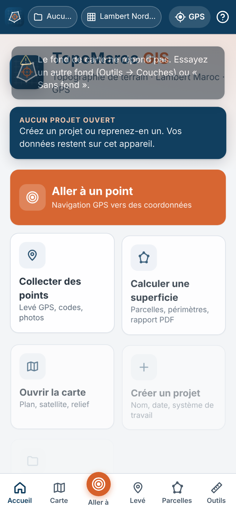
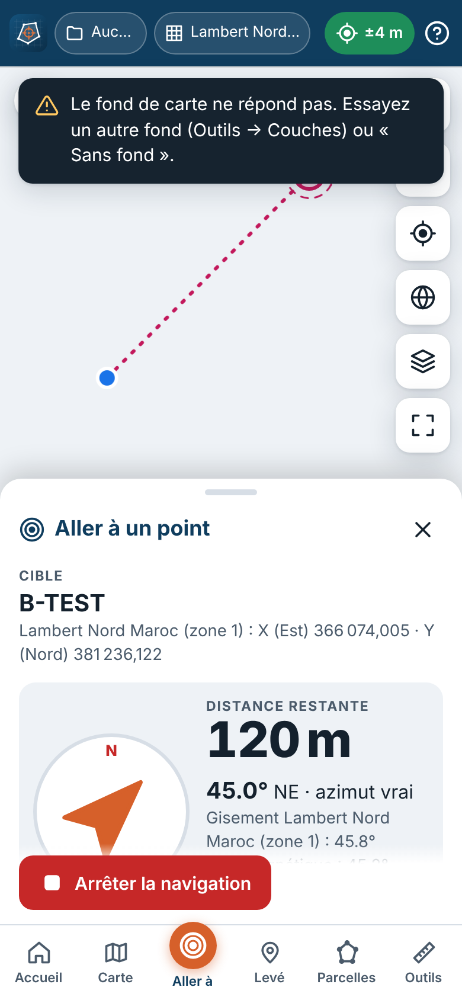
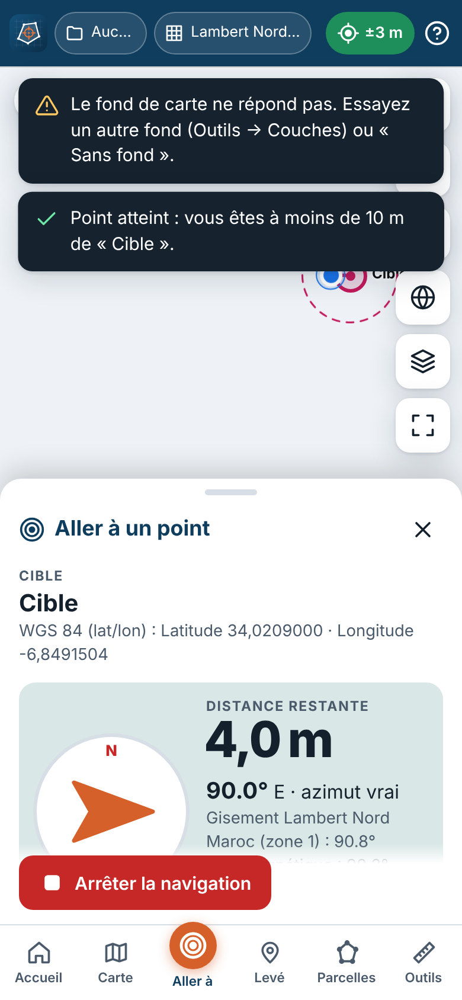
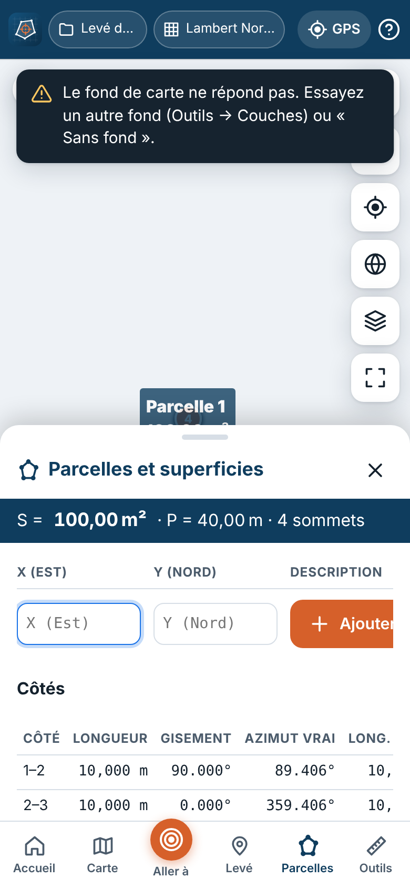

# TopoMaroc GIS

Application SIG topographique de terrain pour le Maroc, utilisable dans le navigateur et installable sur smartphone (PWA). Elle permet de saisir des coordonnées dans les systèmes marocains, de **naviguer au GPS jusqu’à un point connu**, de **lever des points**, de **délimiter des parcelles et d’en calculer la superficie**, puis d’exporter les résultats (CSV, GeoJSON, KML, GPX, XLSX, DXF, PDF).

- **Application en ligne :** https://milyasse.github.io/topomaroc-gis/
- Aucun compte, aucun serveur métier : les données restent sur l’appareil (IndexedDB).
- Fonctionne hors connexion après le premier chargement (saisie, GPS, calculs, exports, sauvegardes).

| Accueil | Navigation GPS | Arrivée | Parcelle |
|---|---|---|---|
|  |  |  |  |

> ⚠️ **Précision.** Un GPS de smartphone donne une position à quelques mètres près (3 à 10 m à ciel ouvert). L’application ne remplace pas un levé par géomètre-topographe (station totale, GNSS RTK) et ses documents ne sont pas des documents cadastraux officiels. Les **calculs** (transformations, superficies) sont, eux, exacts et testés contre des références indépendantes.

---

## Fonctionnalités opérationnelles

### Systèmes de coordonnées
| Système | EPSG | Unité / saisie | Domaine |
|---|---|---|---|
| WGS 84 géographique | 4326 | degrés — latitude puis longitude (décimal ou DMS) | GPS, carte |
| Merchich / Nord Maroc — Lambert zone 1 | 26191 | m — X (Est) puis Y (Nord) | Maroc au nord de 31°30′N |
| Merchich / Sud Maroc — Lambert zone 2 | 26192 | m — X puis Y | Maroc au sud de 31°30′N |
| Merchich / Sahara Nord — Lambert zone 3 | 26194 | m — X puis Y | Provinces du Sud, nord de 24°18′N |
| Merchich / Sahara Sud — Lambert zone 4 | 26195 | m — X puis Y | Provinces du Sud, sud de 24°18′N |
| Merchich géographique | 4261 | degrés — latitude puis longitude | historique |
| WGS 84 / UTM 28N, 29N, 30N | 32628, 32629, 32630 | m — E puis N | fuseaux couvrant le Maroc |

Paramètres (registre EPSG, vérifiés avec PROJ 9.8) : Lambert conique conforme 1SP, ellipsoïde Clarke 1880 (IGN) a = 6 378 249,2 m, 1/f = 293,466021293627, méridien central −5,4° (−6 gr), latitudes d’origine 33,3° / 29,7° / 26,1° / 22,5° (37 / 33 / 29 / 25 gr), facteurs d’échelle 0,999625769 / 0,999615596 / 0,999616304 / 0,999616437, origines (500 000 ; 300 000) pour les zones 1 et 2, (1 200 000 ; 400 000) et (1 500 000 ; 400 000) pour les zones Sahara.

**Transformation Merchich → WGS 84** : EPSG:1166, seule transformation publiée dans le registre EPSG (translations géocentriques ΔX = 31 m, ΔY = 146 m, ΔZ = 47 m ; exactitude ≈ 7 m ; domaine « Maroc continental » 27,66°N–35,97°N). Elle **n’est pas définie pour les zones Sahara** : l’application le signale (PROJ refuse d’ailleurs de l’y appliquer). Des paramètres locaux à 3 ou 7 paramètres (conventions Position Vector ou Coordinate Frame) peuvent être saisis dans les Réglages, avec leur source.

Contrôles de cohérence : valeurs non numériques, degrés saisis dans un système métrique (et inversement), latitude/longitude inversées, longitude positive au Maroc, point hors de la zone de validité, X/Y inversés, suggestion du système probable (ex. UTM saisi comme Lambert), distance anormale par rapport à la position GPS. **Les quatre zones Lambert ayant des plages X/Y qui se recouvrent, une confusion de zone n’est pas détectable par les valeurs seules : la zone doit être choisie explicitement** (et la carte montre où tombe le point).

### Aller à un point (navigation GPS)
Saisie (ou choix d’un point du projet, ou pointé sur la carte) → validation → transformation → affichage de la cible, ligne géodésique position-cible, **distance restante**, **azimut vrai**, **gisement** (Lambert/UTM), **cap magnétique** (déclinaison WMM 2025), précision GPS et heure de la dernière mesure, état de la géolocalisation, alerte **visuelle, sonore et vibration** dans un rayon de 50/20/10/5 m ou personnalisé, avertissement si la précision GPS dépasse le rayon. Boussole du téléphone (si disponible, marquée « indicative » si sa calibration est inconnue), mode **plein écran simplifié**, maintien de l’écran allumé (Wake Lock), boutons Recentrer / Arrêter / Enregistrer le point atteint.

### Levé topographique
Projet (nom, date, observations, système de travail), points GPS ou saisis : identifiant unique, numéro auto-incrémenté, coordonnées WGS 84 et projetées, précision annoncée, date/heure, code configurable (borne, angle de parcelle, point de référence, bâtiment, arbre, route, limite, puits, poteau, clôture…), description, photo. Option **« Attendre une meilleure précision »** (seuil et durée réglables, moyenne pondérée, précision rapportée prudemment). Modifier, supprimer (confirmation), naviguer vers un point, annuler/rétablir (Ctrl+Z / Ctrl+Y), indicateur de qualité.

### Parcelles et superficies
Création par **A** levé GPS des sommets, **B** saisie du tableau des sommets (n°, X, Y, description ; ajout, modification, suppression, réordonnancement), **C** import CSV/GeoJSON/KML/GPX avec correspondance des colonnes, **D** dessin sur la carte (sommets déplaçables). Résultats : superficie (m², a, ha, km², format cadastral « ha a ca »), périmètre, nombre de sommets, longueurs et gisements des côtés, azimuts et longueurs géodésiques, distance entre deux sommets quelconques, total de plusieurs parcelles sélectionnées.

**Méthode** (affichée avec chaque résultat) :
- coordonnées projetées (Lambert, UTM) → superficie **plane** par la formule de Gauss dans la projection : convention des plans topographiques et cadastraux ;
- levé GPS (WGS 84) → superficie **géodésique** exacte sur l’ellipsoïde (GeographicLib, côtés géodésiques), avec contrôle plan dans la zone Lambert ;
- emprise > 10 km → méthode géodésique retenue automatiquement et signalée ; la méthode peut être imposée.
Les deux valeurs (plane / ellipsoïdale) et leur écart sont toujours affichés.

Détection : moins de 3 sommets, fermeture répétée, sommets en double (≤ 1 mm), côtés qui se croisent (auto-intersection), sommets alignés, superficie nulle ou suspecte, coordonnées incompatibles, précision GPS insuffisante pour un usage foncier (> 0,1 m), transformation extrapolée (zones Sahara).

**Rapport PDF** : projet, date, plan coté (échelle graphique, nord), tableau des sommets (Lambert + WGS 84), tableau des côtés (longueurs, gisements en grades ou degrés, longueurs géodésiques, azimuts), superficie et périmètre, système, méthode, qualité estimée, mention « ne constitue pas un document cadastral officiel ». [Exemple](docs/exemple-rapport-parcelle.pdf).

### Nouveautés v1.4 — visibilité des parcelles et page Version
- Chaque parcelle s'affiche ou se masque sur la carte, comme une couche : œil dans la liste des parcelles, cases à cocher dans Outils → Couches (projet ouvert), boutons « Afficher uniquement celle-ci » / « Masquer sur la carte » dans la fiche et dans la bulle de la carte, « Tout afficher » / « Tout masquer ».
- Masquer une parcelle partagée masque ses lots. Le masquage est mémorisé (IndexedDB) et s'applique aussi quand le projet est superposé ; il ne touche que la carte : listes, totaux, rapports et exports gardent toutes les parcelles.
- Page **Version de l'application** (`#/about`, accessible depuis l'accueil, les Réglages et l'Aide) : numéro, date, publication (commit), mode installé ou navigateur, cache hors connexion, stockage, recherche de mise à jour, historique complet.

### Nouveautés v1.3 — projection automatique selon la zone
- Le système de projection est choisi automatiquement d'après la zone où l'on se trouve : position GPS (précision ≤ 2 km), ou centre de la carte (zoom ≥ 9) si le GPS est éteint. La puce du système affiche un badge **AUTO** et un message signale chaque changement de zone.
- Limites (domaines d'usage EPSG enregistrés dans `src/core/crs.js`) : Lambert Nord au nord de 31,5° N, Sud de 27,665° à 31,5° N, Sahara Nord de 24,3° à 27,665° N, Sahara Sud au sud de 24,3° N ; option UTM 28/29/30 selon la longitude. Hystérésis de 0,02° (~2 km) le long des limites (`src/core/zones.js`).
- **Chaque point collecté** (levé GPS, « + Point », point pointé sur la carte, point atteint en navigation, déplacement d'un point) est enregistré dans la zone de **sa propre position** (`src/services/autocrs.js`). Réglages → « Recalculer dans leur zone » met à jour les points déjà levés (WGS 84 inchangé, ancienne valeur conservée dans `input.original`).
- Choisir un système à la main désactive le mode automatique (réactivable dans la puce ou les Réglages). Les parcelles gardent leur système de création ; la superficie plane d'une parcelle en WGS 84 est calculée dans la zone de son centre.

### Nouveautés v1.2
- **Déplacer un point** depuis sa fiche : nouvelles coordonnées, glisser sur la carte (ou au réticule) ou position GPS actuelle ; l'historique des positions est conservé et les **sommets de parcelles rattachés au point suivent** (après confirmation).
- **Couches par projet** (Outils → Couches) : superposition de plusieurs projets, chacun avec sa couleur et ses couches Points / Parcelles / Lignes activables ; le projet ouvert reste modifiable, les autres sont en lecture seule.
- **Pente** : pour chaque parcelle, altitudes min/max/moyenne, dénivelé, pente moyenne et maximale (% et °, méthode de Horn), exposition et classe de pente ; outil **« Pente entre deux points »** avec profil en long. Source : MNT ouvert Terrarium (SRTM ~30 m, disponible jusqu'au zoom 15 au Maroc — mesuré), précision indicative ± 5 à 10 m. Altitude des points (saisie, GPS ou MNT).
- **Numéro de version** affiché (accueil, aide avec historique des nouveautés, réglages, rapports PDF) avec l'identifiant de publication.

### Nouveautés v1.1
- **Satellite à fort zoom** : mesure réelle de la disponibilité au Maroc ([docs/resultats-tests/tuiles.json](docs/resultats-tests/tuiles.json)) — l'imagerie Esri existe jusqu'au zoom 18 en zone rurale (19 en ville, 17 à Dakhla) ; au-delà le serveur renvoie une tuile grise. L'application détecte ces tuiles vides et **agrandit automatiquement la meilleure image disponible** (badge « Imagerie max. ici : zoom 18 »). Fonds satellite : Esri, Esri Clarity, Sentinel-2 2023 (EOX, usage non commercial), **fond personnalisé** (URL XYZ sous licence de l'utilisateur).
- **« + Point » sur la carte** : placement au réticule ou au toucher, sans GPS, en série.
- **Sélection multiple de points** → *Créer une parcelle* (contour automatique sans croisement, ordre de sélection ou numéros) ou *Ajouter à une parcelle* (insertion au meilleur endroit du contour).
- **Dessin** : accrochage aux points et sommets existants (limites communes exactes), fermeture en touchant le premier sommet, barre d'action flottante, panneau réduit automatiquement.
- **Partage d'une parcelle entre personnes** : parts en % ou en fractions (1/8, 7/16…), contrôle de la somme à 100 %, côté d'accès facultatif, **propositions de découpage** (bandes perpendiculaires donnant une façade à chacun, ou parallèles) classées par compacité et contiguïté, réglage fin de l'orientation, **superficies exactes** (dichotomie, écart < 1 mm²), génération des lots associés à chaque personne, **couleurs distinctes**, étiquettes nom / superficie / %, rapport PDF de partage. Proposition technique, sans valeur juridique.
- **Association d'une parcelle à une personne** et **fiche projet** (statistiques, superficie totale, superficie par personne).
- Ergonomie et performance : rendu de carte différé, étiquettes adaptées à la place disponible, rendu Canvas au-delà de 300 points, alertes de fond de carte non répétées.

### Carte et outils
Leaflet (plan OpenStreetMap, satellite Esri, relief OpenTopoMap, fond clair CARTO, « sans fond » pour le hors ligne), couches activables et ordonnables, légende, coordonnées au toucher dans tous les systèmes (avec « Aller à », « Ajouter un point », « Copier »), barre de coordonnées (curseur ou centre) dans le système choisi, échelle, zoom, emprise initiale/projet, plein écran, suivi GPS, mesure de distances et de superficies (géodésiques), convertisseur de coordonnées, recherche de coordonnées et de lieux (Nominatim), historique des mesures, déclinaison magnétique et convergence des méridiens.

### Imports / exports
| Format | Import | Export | Remarques |
|---|---|---|---|
| CSV | ✔ (`;` `,` tabulation, virgule décimale, DMS, sans en-tête) | ✔ standard et « Excel français » | système demandé et confirmé à l’import ; fichier `-SRC.txt` joint à l’export |
| GeoJSON | ✔ (membre `crs` lu) | ✔ RFC 7946 (WGS 84) et variante projetée (lue par QGIS) | |
| KML / GPX | ✔ | ✔ | WGS 84 par définition |
| XLSX | — | ✔ (Points, Parcelles, Sommets, Côtés, Métadonnées) | |
| DXF | — | ✔ AutoCAD R12 (calques POINTS, PARCELLES, LIGNES, NUMEROS, SURFACES) | coordonnées projetées ; système dans `-SRC.txt` |
| PDF | — | ✔ rapport de superficie, fiche de levé | |
| Sauvegarde JSON | ✔ restauration sans écrasement | ✔ un projet ou tous (photos incluses) | |

### Interface
Écran d’accueil (créer/reprendre un projet, aller à un point, collecter, superficie, carte, import), carte plein écran avec panneau inférieur glissable (mobile) ou latéral (ordinateur), boutons ≥ 44 px, thème clair/sombre/automatique, **contraste renforcé** pour le plein soleil, animations GSAP (désactivées si « réduire les animations » est demandé par le système), confirmations avant suppression, aide contextuelle, unités toujours affichées, système actif visible en permanence. Français ; architecture i18n prête pour l’arabe (sens RTL géré).

---

## Utilisation

1. Ouvrir https://milyasse.github.io/topomaroc-gis/ (HTTPS requis pour le GPS) et autoriser la localisation.
2. Installer : Android/Chrome → menu ⋮ → *Installer l’application* ; iPhone/Safari → Partager → *Sur l’écran d’accueil*.
3. *Créer un projet*, choisir le système de travail (ex. Lambert Nord Maroc).
4. *Aller à un point* : choisir le système **et la zone**, saisir X/Y, *Démarrer la navigation*.
5. *Levé* : se placer sur le point, choisir le code, *Enregistrer le point GPS*.
6. *Parcelles* → *Nouvelle parcelle* → mode A/B/C/D → lire superficie et périmètre → *Rapport PDF* / *Exporter*.
7. *Projets* → *Sauvegarder tout* régulièrement (le navigateur peut effacer les données en cas de manque d’espace si le stockage persistant n’est pas accordé).

## Installation locale / développement

Aucune compilation : l’application est faite de modules ES servis tels quels (compatible GitHub Pages).

```bash
git clone https://github.com/milyasse/topomaroc-gis.git
cd topomaroc-gis
python3 -m http.server 8080          # puis http://localhost:8080
node --test tests/unit/*.test.mjs    # tests unitaires (Node ≥ 20)
npm i --no-save playwright && npx playwright install chromium
node tests/e2e/e2e.mjs http://127.0.0.1:8080/   # tests navigateur
node tools/gen-precache.mjs          # à relancer après toute modification (liste hors ligne)
```

Bibliothèques tierces : regroupées en modules ESM dans `vendor/` par le workflow `Vendor libraries & PROJ reference` (`tools/vendor/build-vendor.sh`), qui génère aussi les valeurs de référence `tests/reference/proj_reference.json` avec **PROJ (pyproj), GeographicLib-C et Shapely**, et copie le modèle WMM 2025.

### Architecture
```
src/core/      calculs purs : crs.js (systèmes, Helmert, contrôles), geodesy.js, geometry.js,
               parcel.js (superficies, validité), angles.js, units.js, magnetic.js (WMM)
src/services/  gps.js (suivi, états, moyenne), compass.js, storage.js (IndexedDB, sauvegardes),
               history.js (annuler/rétablir), nmea.js (base pour récepteur GNSS externe/RTK)
src/io/        csv.js, formats.js (GeoJSON, KML, GPX, DXF), office.js (XLSX, PDF)
src/map/       map.js (Leaflet, couches, GPS, cible), basemaps.js (fournisseurs interchangeables)
src/ui/        écrans : nav, survey, parcels, tools, projects, settings, help, transfer
tests/         unit/ (node:test), e2e/ (Playwright), reference/ (PROJ)
```
Choix techniques : JavaScript moderne typé par JSDoc (vérifié avec `tsc`), sans framework ni étape de build pour rester simple à maintenir et à héberger ; **Leaflet** plutôt qu’OpenLayers (plus léger, excellent sur mobile ; les reprojections sont faites en amont, la carte reste en Web Mercator) ; **proj4js** pour les formules de projection, avec inverse affinée par Newton et changement de datum (Helmert) implémenté et testé ; **GeographicLib** pour la géodésie ; **jsPDF**, **write-excel-file**, **PapaParse**, **togeojson** ; **GSAP** pour les animations.

## Tests

Voir [docs/TESTS.md](docs/TESTS.md). Résumé : 64 tests unitaires (dont partage de parcelles, assemblage de contours et pente) (transformations identiques à PROJ à < 1 mm, superficies identiques à Shapely/GeographicLib-C, WMM identique à la NOAA) et 31 scénarios navigateur (GPS simulé : autorisation refusée, position indisponible, précision insuffisante, perte de signal, navigation et arrivée, hors connexion, import/export, sauvegarde/restauration…), exécutés à chaque publication, y compris **sur l’URL publique**.

## Dépendances externes et limites connues

- **Fonds de carte** en ligne (OpenStreetMap, Esri, OpenTopoMap, CARTO) : soumis aux conditions de leurs fournisseurs (attribution, usage modéré ; usage commercial de CARTO/Esri soumis à licence). Pas de téléchargement de tuiles pour le hors ligne (interdit par la politique OSM) : hors réseau, utiliser « Sans fond ». Les limites administratives affichées relèvent des fournisseurs ; aucun fond n’est une référence cadastrale.
- **Recherche de lieux** : Nominatim (OpenStreetMap), en ligne uniquement.
- **MNT (pente)** : tuiles Terrarium (AWS Open Data / Mapzen, sources SRTM et autres), en ligne uniquement ; pentes indicatives.
- **GPS** : précision de l’appareil ; l’altitude affichée est indicative.
- **Boussole** : dépend des capteurs ; iOS demande une autorisation ; direction « indicative » sans information de calibration.
- **Merchich → WGS 84** : ≈ 7 m (EPSG:1166) ; non défini dans les zones Sahara.
- Testé en Chromium (mobile/tablette/ordinateur émulés). **Non testé sur appareils iOS/Android physiques** dans cette version.

## À développer ensuite
- Connexion d’un récepteur GNSS externe / RTK (Web Bluetooth / Web Serial, NMEA — analyseur déjà présent).
- Traduction arabe (dictionnaire `src/i18n/ar.js`).
- Fonds de carte hors ligne (MBTiles/PMTiles fournis par l’utilisateur, sous licence compatible).
- Synchronisation facultative entre appareils.
- Import DXF et Shapefile.

## Sources
Registre EPSG (IOGP) ; PROJ ; GeographicLib (C. Karney) ; World Magnetic Model 2025 (NOAA/NGA) ; politiques d’usage OSMF (tuiles, Nominatim). Licences des bibliothèques : `vendor/licenses/`, versions : `vendor/VERSIONS.json`.
